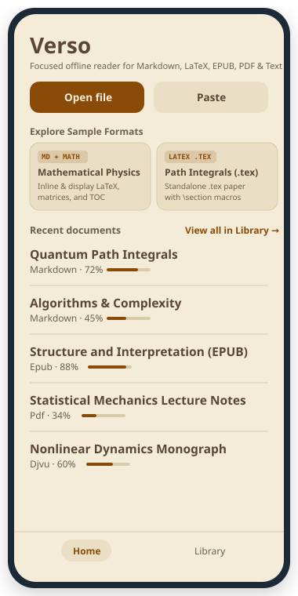
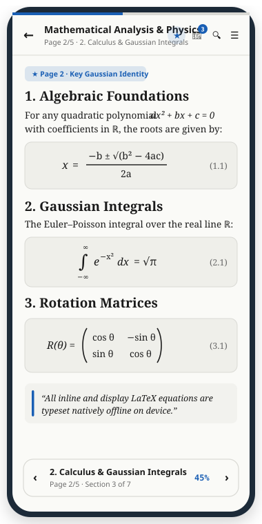
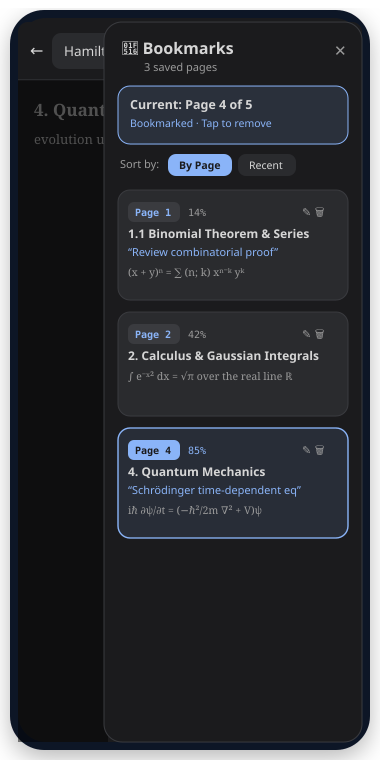

<div align="center">

# Verso

**An offline-first Android sanctuary for books, scientific papers, LaTeX manuscripts, and technical docs.**

[-3DDC84?logo=android&logoColor=white)](#requirements)
[](#architecture--performance)
[](#native-latex--math-typesetting)
[](#supported-formats--file-extensions)
[](#privacy--security-by-design)

*Reflow any technical paper, book, or note into continuous, comfortable typography — with native on-device $\LaTeX$ equation rendering, hierarchical Table of Contents, instant full-text search, and persistent page bookmarks.*

</div>

---

## Screenshots

<p align="center">
  
  &nbsp;&nbsp;
  
  &nbsp;&nbsp;
  
</p>

| **Home & Format Showcase** | **Native $\LaTeX$ & GFM Tables** | **Full-Text Search & Bookmarks** |
| :--- | :--- | :--- |
| Instant access to recent books, format badges (`PDF`, `EPUB`, `DJVU`, `MD`, `HTML`, `TXT`), and 5 built-in interactive sample documents. | Pure Compose 2D equation layout: fractions, nested radicals, integrals, matrices, Greek symbols, and math inside tables. | Slide-in **Bookmarks Sidebar**, hierarchical **Table of Contents**, and real-time **Full-Text Search** with highlighted snippets. |

---

## Why Verso?

Reading technical documents, academic preprints, and ebooks on a phone usually forces an uncomfortable compromise: pinch-zooming two-column PDFs or staring at unrendered raw `$...$` $\LaTeX$ code in Markdown viewers.

**Verso fixes both:**
1. **Reflow instead of pinch-and-zoom** — Documents are parsed into a unified semantic block AST (`Heading`, `Paragraph`, `MathBlock`, `CodeBlock`, `TableBlock`, `Quote`, `ListItem`) that wraps cleanly to your screen width at your chosen font size (12sp–48sp).
2. **First-class $\LaTeX$ math everywhere** — Inline (`$...$`, `\(...\)`) and display (`$$...$$`, `\[...\]`, `\begin{equation}`, `\begin{align}`, `\begin{pmatrix}`) equations render natively in Jetpack Compose without WebViews or external network calls.
3. **100% offline & private** — Verso does **not** request `android.permission.INTERNET` (enforced by automated manifest guard tests). Every document lives in app-private storage.

---

## Key Features

### Native $\LaTeX$ & Math Typesetting
- **2D Structural Compose Layout**: Stacked fractions (`\frac`, `\dfrac`, `\tfrac`), binomial coefficients (`\binom`), scalable radicals (`\sqrt[n]{x}`) with custom Canvas vinculum bars, and big operators (`\sum`, `\prod`, `\int`, `\oint`, `\lim`) with upper/lower limits.
- **Matrices & Environments**: Supports `matrix`, `pmatrix`, `bmatrix`, `Bmatrix`, `vmatrix`, `Vmatrix`, `cases`, `aligned`, `gather`, and `equation` environments with custom scalable delimiters (`\left` / `\right`).
- **Comprehensive Symbol & Accent Coverage**: Full Greek alphabet, binary/relational operators, arrows, blackboard bold (`\mathbb{R}`), calligraphic (`\mathcal{L}`), vector arrows (`\vec`), hats (`\hat`), bars (`\bar`), over/underbraces, and `\text{...}` spans.
- **Smart Inline Blending**: Simple single-line inline math blends directly into surrounding paragraph text using `AnnotatedString` baseline shifts, while 2D inline structures (fractions, roots, matrices) embed seamlessly via dynamic `InlineTextContent` measurement.

### Navigation for Long Books & Papers
- **Hierarchical Table of Contents (TOC)**: Automatically extracted from document headings (`H1`–`H6`) or synthesized for long plain-text works. Features active-section tracking via $O(\log N)$ binary search, progress badges, and a quick **"Next Section"** pill.
- **Instant Full-Text Search**: Search across all blocks (including headings, paragraphs, code blocks, quotes, lists, tables, and $\LaTeX$ equations) with debounced background indexing, match counter, contextual snippet previews, and Next/Previous jump controls.
- **Page Bookmarks & Slide-In Sidebar**: Bookmark any position with a single tap in the top bar. Open the **Bookmarks Sidebar** to review saved locations with block previews, completion percentages, and relative timestamps, or jump directly to a saved spot.

### Tailored Reading Comfort
- **5 Curated Reading Themes**: **System**, **Light**, **Sepia** (warm archival paper), **Dark**, and **Black (AMOLED)** for zero-glare late-night reading.
- **Full Typography Controls**: Choose **Serif**, **Sans-Serif**, or **Monospace** fonts; adjust font size (`12sp`–`48sp`), line height (`1.1x`–`2.2x`), paragraph spacing, horizontal margins, and **Start** vs. **Justified** alignment.
- **Rich Technical Blocks**:
  - **GFM Tables**: Proportional column sizing, header styling, alternating row striping, and inline $\LaTeX$ rendering inside cells.
  - **Code Blocks**: Monospace container with language badge, one-tap clipboard copy, and horizontal scrolling.
  - **Blockquotes & Theorems**: Styled callout containers for quotes, theorems, lemmas, proofs, and abstracts.

---

## Supported Formats & File Extensions

Verso detects files via **magic byte signatures**, **MIME types**, and **file extensions**, allowing you to open files from the Android file picker, share sheet, external file managers, or clipboard paste:

| Category | Supported Extensions | Format Engine & Capabilities |
| :--- | :--- | :--- |
| **Markdown & Technical Notes** | `.md`, `.markdown`, `.mkd`, `.rmd`, `.qmd` | Full CommonMark + GFM tables, fenced code blocks, blockquotes, lists, and inline/display $\LaTeX$ math (`$...$`, `$$...$$`). |
| **$\LaTeX$ Manuscripts** | `.tex`, `.ltx`, `.latex` | Strips preambles (`\documentclass`, `\usepackage`) and `%` comments; converts `\section`, `\subsection`, `\title`, `\author`, `abstract`, `theorem`/`lemma`/`proof`, `itemize`/`enumerate`, `verbatim`/`lstlisting`, and all math environments into reflowed blocks. |
| **EPUB Ebooks** | `.epub` | Parses OPF spine & XHTML chapters in reading order with full chapter headings, inline formatting, and embedded math protection. |
| **PDF Documents** | `.pdf` | Extracts text layers via PDFBox-Android and reconstructs paragraphs, headings, and reading flow without horizontal scrolling. |
| **DjVu Documents** | `.djvu`, `.djvo` | Parses IFF85 `AT&TFORM` `DJVU`/`DJVM` containers and extracts embedded `TXTa` / `ANTa` UTF-8 text layers into reflowable paragraphs. |
| **FictionBook Ebooks** | `.fb2` | Parses XML FictionBook 2 structure (`<book-title>`, `<section>`, `<title>`, `<epigraph>`, `<poem>`, `<stanza>`) with math support. |
| **Web & Articles** | `.html`, `.htm`, `.xhtml` | Strips navigation chrome, scripts, and styles via Jsoup; preserves semantic headings, tables, code, and $\LaTeX$ equations. |
| **Structured Markup** | `.org`, `.rst`, `.adoc`, `.asciidoc` | Converts Org-mode (`#+TITLE:`, `* Heading`), reStructuredText, and AsciiDoc (`= Heading`) into structured Verso headings and paragraphs. |
| **Plain Text & Logs** | `.txt`, `.text`, `.log` | Automatic character encoding detection (UTF-8, UTF-16LE/BE, Windows-1252) and smart blank-line paragraph reflow. |

> **Note on Scanned PDFs & DjVu Files:** Verso is a text-reflow reader. If a `.pdf` or `.djvu`/`.djvo` file contains only scanned page images without an embedded OCR text layer, Verso cleanly reports that no text layer is present.

---

## Architecture & Performance

Verso is engineered for **60/120fps scrolling**, **low memory footprint**, and **minimal battery drain** on mobile devices:

```text
app/src/main/java/app/verso/
├── core/
│   ├── model/       # @Immutable AST: Document, Block, Inline, TableCell
│   ├── importer/    # Magic-byte & extension FormatDetector, streaming DocumentImporter
│   ├── latex/       # Zero-WebView recursive-descent LatexParser & symbol maps
│   ├── markdown/    # CommonMark + GFM Tables + LaTeX manuscript & Org/AsciiDoc preprocessor
│   ├── epub/        # Safe ZIP streaming & OPF spine extractor
│   ├── pdf/         # On-device PDF text layer reconstruction
│   ├── djvu/        # IFF85 DJVU/DJVM TXTa & ANTa chunk parser
│   ├── html/        # Jsoup article & FictionBook (.fb2) extractor with MathProtector
│   ├── text/        # BOM/charset detector & paragraph normalizer
│   ├── toc/         # O(log N) binary-search Table of Contents extractor & tracker
│   └── search/      # Background full-text indexer & contextual snippet generator
└── reader/
    ├── data/        # Room v3 database (Documents + Bookmarks), DataStore reader settings
    └── ui/          # Jetpack Compose screens: Home, Library, Reader, LatexRenderer, Modals
```

### Speed, Memory & Battery Optimizations
- **Compose Strong Skipping & `@Immutable` Models**: Every AST node (`Document`, `Block`, `Inline`, `TableCell`, `TocEntry`, `SearchMatch`) is marked `@Immutable` so Jetpack Compose skips unnecessary recompositions when scrolling or toggling toolbars.
- **LRU Parsed-Equation Cache**: `LatexParser` caches up to 256 parsed `MathNode` ASTs in a thread-safe `LruCache`, eliminating redundant parsing during fast `LazyColumn` flings.
- **Zero-Allocation Canvas Drawing**: `LatexRenderer` reuses remembered `Path` instances (`reusablePath.reset()`) inside `SqrtLayout`, `ScalableDelimitedLayout`, and `AccentLayout` `drawWithContent` lambdas to prevent GC churn at 120Hz.
- **Precomputed Prefix Sums & $O(\log N)$ Lookups**: Reading completion percentages and active TOC sections use precomputed character-weight arrays and binary search instead of per-frame linear scans.
- **Debounced Persistence & Search**: Scroll reading position saves are debounced (`800ms`) and skip no-op writes (`lastSavedIndex`/`lastSavedOffset`), reducing SQLite flash wear and background CPU wakeups; search runs on `Dispatchers.Default` with `180ms` debounce.
- **True Black AMOLED Support**: The **Black** theme uses pure `#000000` surfaces to turn off OLED subpixels during extended reading sessions.

---

## Getting Started

### Build & Run from Source

Verso is a standard Gradle Android project targeting **Android 8.0 (API 26)+**.

```bash
# 1. Clone the repository
git clone https://github.com/Eran-Rehani/Verso.git
cd Verso

# 2. Build the debug APK
gradle :app:assembleDebug

# 3. Run unit & Robolectric verification tests
gradle :app:testDebugUnitTest
```

Detailed build instructions are available in [docs/BUILDING.md](docs/BUILDING.md).

### Installing on Your Phone
1. Build the APK (`app/build/outputs/apk/debug/app-debug.apk`) or export the APK from AI Studio (**Settings → Export APK**).
2. Transfer the `.apk` file to your Android phone or install via USB with `adb install -r app/build/outputs/apk/debug/app-debug.apk`.
3. Tap **Load Showcase** on the Home screen to immediately explore 5 built-in sample documents covering Markdown, $\LaTeX$ calculus & physics, algorithms, and classical literature.

---

<a id="privacy--security-by-design"></a>
<a id="privacy"></a>
## Privacy & Security by Design

- **Zero Network Access**: Verso declares **no `android.permission.INTERNET`** in `AndroidManifest.xml`, verified on every test run by `ManifestGuardTest`.
- **Sandboxed Intake**: Imports enforce a 64 MiB file size cap, EPUB zip-bomb expansion limits, and safe on-device parsing without macro execution or remote resource loading.
- **App-Private Storage**: Imported books and Room database states stay in app-private storage with Android cloud backup disabled.

---

## Roadmap & Feature Requests

Curious about upcoming enhancements? Check out:
- [ROADMAP.md](ROADMAP.md) — Product roadmap & architectural milestones
- [docs/FEATURE_REQUESTS.md](docs/FEATURE_REQUESTS.md) — Detailed feature proposals & UI/UX enhancements

Bugs, format quirks, and feature requests are welcome in [GitHub Issues](https://github.com/Eran-Rehani/Verso/issues).
